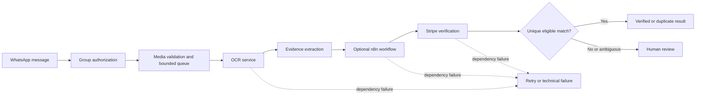

# Architecture overview

The application receives payment receipt images through a WhatsApp bot, extracts candidate evidence, and uses server-side checks to compare that evidence with eligible Stripe records. n8n can orchestrate the OCR-to-verification request. Uncertain or technically unavailable results remain review-required rather than being treated as payment approval.

## Processing path

The main WhatsApp flow is in `src/whatsapp/`. OCR and extraction are in `src/ocr/` and `src/extraction/`. Stripe verification is in `src/verification/stripe_verifier.py`; queue and message orchestration live in the WhatsApp service. Versioned workflow exports are in `n8n/workflows/`.

## Trust boundaries and data handling

| Boundary | Data crossing it | Control to preserve |
| --- | --- | --- |
| WhatsApp to bot | Message metadata, captions, receipt image | Enforce the configured group allowlist before downloading or processing media; validate size and media type. |
| Bot to OCR service | Temporary image bytes and processing metadata | Keep the service on a private network, bound request size and time, and remove temporary files according to the deployment's retention policy. |
| OCR/model provider | Image or extracted text, depending on provider | Tesseract runs locally. Enabling a cloud vision provider sends its configured input to that provider; disclose and review this data flow. |
| Orchestrator to Stripe verifier | Structured receipt evidence and service authentication | Authenticate service calls, bound lookup work, and keep Stripe credentials server-side. |
| Verifier to WhatsApp response | Verification status and limited evidence | Do not send full Stripe candidate objects or credentials to a group. Keep ambiguous cases private and review-required. |

## Decision rules

- OCR and model output provide candidate evidence; Stripe responses and explicit eligibility checks determine whether a payment can be verified.
- A unique eligible match may be accepted. A duplicate remains a duplicate. No match or multiple plausible matches require review.
- Timeouts, malformed responses, and dependency outages are technical failures. They must not be represented as proof that a payment is invalid.
- Recovery attempts are bounded. A recovery result replaces the original only when it is authoritative or materially stronger; failure to recover preserves the review path.
- Idempotency and duplicate checks prevent repeated processing from being treated as a new payment.

These are design notes based on the repository implementation. They do not certify any deployed configuration or prove that the current production instance has this exact revision.
